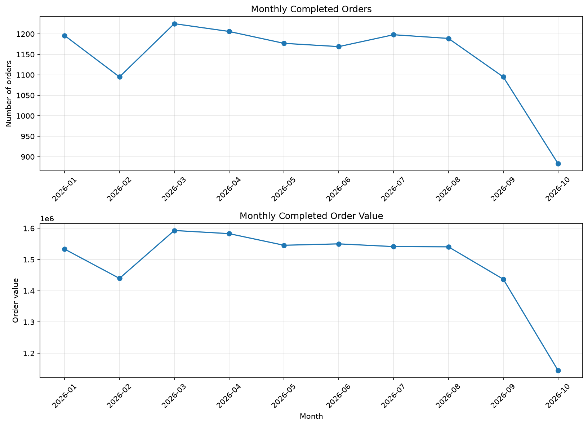

# CartGhost — E-commerce Data Analytics

## Project Overview

CartGhost is an e-commerce data analytics portfolio project that explores order performance, monthly trends, product category performance, and potential customer churn using Python and PostgreSQL.

The project demonstrates data cleaning, validation, aggregation, SQL window functions, trend analysis, and rule-based customer segmentation.

**Dataset:** Synthetic e-commerce order data  
**Analysis period:** January 1 – October 22, 2026  
**Tools:** Python, pandas, NumPy, Matplotlib, PostgreSQL, SQL, Git

## Business Objectives

 Analyze completed, cancelled, and returned orders.
 Calculate completed order value and average order value.
 Measure month-over-month changes in order volume and order value.
 Compare completed-order performance across product categories.
 Identify customers meeting a defined potential churn rule.

## Key Findings

### 1. Order Performance

The dataset contains 13,000 orders.

| Order status | Orders | Percentage |
|---|---:|---:|
| Completed | 11,433 | 87.95% |
| Cancelled | 1,038 | 7.98% |
| Returned | 529 | 4.07% |
| **Total** | **13,000** | **100.00%** |

Completed orders accounted for 87.95% of all orders. Cancelled and returned orders together accounted for 12.05%.

### 2. Completed Order Value

 **Completed orders:** 11,433
 **Unique customers with completed orders:** 2,470
 **Total completed order value:** 14,908,918.65
 **Average completed order value:** 1,304.03

The dataset's currency unit has not been specified, so monetary figures are reported without a currency symbol.

### 3. Monthly Trends

- **Highest completed order volume:** March, with 1,225 orders.
- **Highest total completed order value:** March, at 1,593,022.70.
- **Highest average order value:** June, at 1,326.10.

March was the strongest complete month by completed order volume and total order value.

### Monthly Trends Visualization

### 4. Month-over-Month Analysis

- February recorded an 8.44% decrease in completed orders compared with January.
- March rebounded, with completed orders increasing 11.87% and total order value increasing 10.65%.
- September recorded decreases of 7.91% in completed orders and 6.72% in total order value.
- October showed decreases of 19.36% in orders and 20.35% in order value compared with September. However, October data ends on October 22, so this is a partial-month comparison and should not be interpreted as a like-for-like decline.

### 5. Category Performance

Snacks ranked first by total completed order value at 2,589,313.03, followed by Personal Care at 2,528,592.18.

Snacks also recorded the highest number of completed orders, at 1,970.

### 6. Potential Customer Churn

Using a rule requiring at least two completed orders and at least 45 days since the last completed order, measured on October 22, 2026:

- **Potentially churned:** 1,097 customers (44.41%)
- **Active / not yet qualified:** 1,373 customers (55.59%)

These percentages use the 2,470 customers with at least one completed order. The classification is rule-based and is not a machine-learning prediction.

## Methodology

1 Validate the dataset and inspect data quality.
2 Analyze order status and completed-order performance.
3 Aggregate completed orders by month.
4 Calculate month-over-month changes using SQL window functions.
5 Rank product categories by completed order value.
6 Calculate customer purchase activity and apply the potential churn rule.

## Limitations

- The dataset is synthetic and does not represent actual customers or a real company.
- October is a partial month, ending October 22, 2026.
- Potential churn is defined by an inactivity rule and does not establish that a customer has permanently left.
- The dataset's currency unit is unspecified.

## Future Improvements

- Develop a dashboard for monthly and category performance.
- Compare customer retention across product categories.
- Test different inactivity thresholds.
- Add additional data-quality and automated validation checks.

## Project Deliverables

- Python scripts for synthetic data generation, data validation, and analysis.
- PostgreSQL queries for business analysis.
- Monthly trend CSV and visualization.
- Customer-level potential churn results.
- Business findings report.

